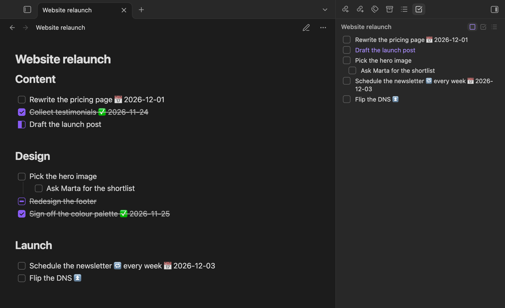
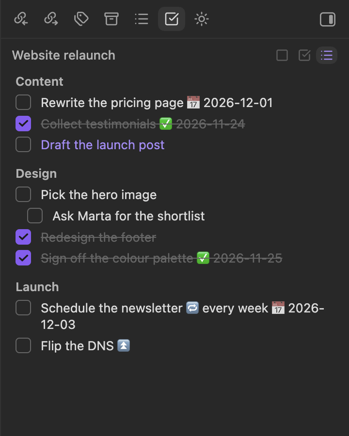
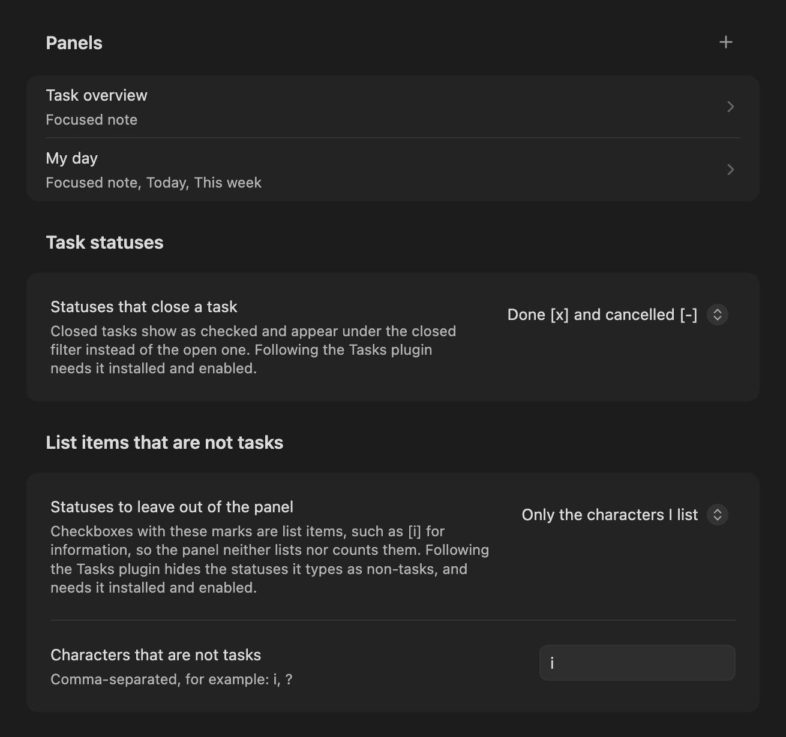
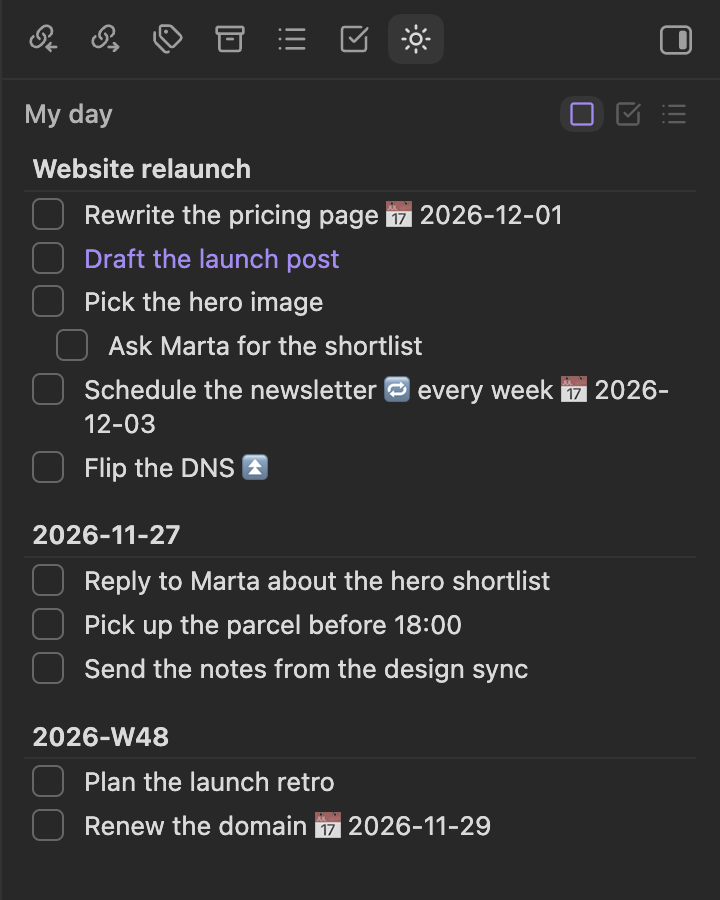
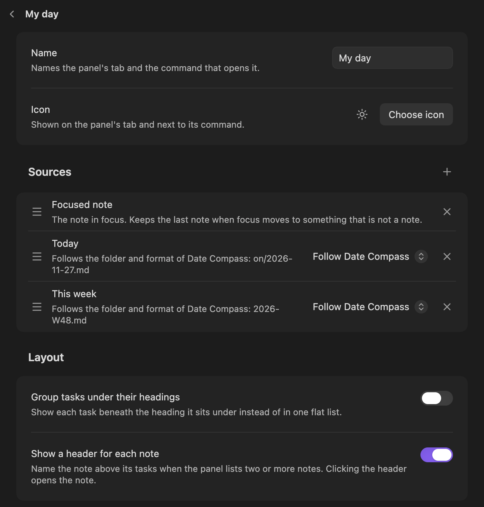

# Task Overview

Obsidian sidebar panels that list the tasks of the note you have in focus, of today's or this week's note, or of any notes you pick, so you can see and tick off their checkboxes without scrolling through them.



## What it does

Out of the box the panel follows the note in focus the way the Calendar plugin follows the active date, so switching notes swaps the list and editing the note refreshes it. With no note in focus it says so instead of leaving the last note's tasks on screen.

Three filters sit above the list — open, completed or cancelled, and all — and each filter button reports through its accessible label how many tasks in the current note it matches, so a screen reader announces how much is left without walking the list.

Clicking a row opens the note and puts the cursor on that task's line, which makes the panel a table of contents for the work in a long note. Ticking a checkbox in the panel writes the change back to the file, so the note stays the single source of truth.

Turning on "Group tasks under their headings" in a panel's settings splits the list by the nearest heading above each task, which keeps a note with several sections readable.





## Panels and sources

A fresh install has one panel, Task overview, that lists the note in focus. Under Settings → Task Overview → Panels you can add more, and each panel has its own name, icon, filter, layout toggles and list of sources. Clicking a panel in the list opens its page, which is also where you move it up or down the list and remove it. The status settings stay shared, because they describe how your vault writes checkboxes rather than what one panel shows.

A source is a note the panel reads. Press + in a panel's Sources list and pick one:

| Source | Lists the tasks of |
| --- | --- |
| Focused note | the note in focus, keeping the last one when focus moves to something that is not a note |
| Today, This week, This month, This quarter, This year | the periodic note of the current period |
| Note… | one note you pick from the vault; the source follows the note when you rename or move it |



Sources are read in list order, and a note reached by two sources, such as Focused note and Today while today's note is open, is listed once at the first source's position. With two or more notes in a panel each one gets a header with its name, which opens the note when clicked; "Show a header for each note" turns the headers off for one flat list. A periodic note that does not exist yet, or a picked note that was deleted, shows as a muted header saying so. A panel that resolves to a single note is titled after that note, and otherwise shows its own name.

### Where periodic notes live

A periodic source follows another plugin's folder and name format by default, so changing them there never leaves a stale copy here. It follows the first of these that provides the period:

1. [Date Compass](https://github.com/carlesba/obsidian-date-compass)
2. [Periodic Notes](https://github.com/liamcain/obsidian-periodic-notes)
3. the core Daily notes plugin, for Today only

The source's description names the plugin it follows and the note it resolves to. When no plugin provides the period, the settings show a warning under the Sources list and the source lists nothing until one is enabled. Switching a source to Custom gives it its own folder and [Moment.js format](https://momentjs.com/docs/#/displaying/format/), prefilled with the values it was following and shown in their own group below the list, and shows today's date in that format as you type.

### Opening panels

Every panel has a command, "Open" followed by the panel's name, which you can bind to a hotkey or pin with a plugin such as Commander. A panel opens in the right sidebar, and running its command again reveals the tab it already has. The ribbon icon opens the first panel in the list. Renaming a panel renames its command and tab and keeps the hotkey; deleting a panel closes its tab.

### Step by step: a "My day" panel

This example builds a panel that shows the note you are working in next to today's and this week's notes and one project note, all in one list.

1. Open Settings → Task Overview and press **Add a panel** under Panels, then pick **Empty panel**.
2. Click the new panel, called New panel, to open its page. Set **Name** to `My day`, and use **Icon** to search for and pick an icon such as `sun`.
3. Under **Sources**, press **Add a source** and pick **Focused note**. Repeat for **Today** and **This week**, then pick **Note…** and search for your project note.
4. Check the description of the Today and This week rows. Each names the plugin it follows, such as Date Compass, and the note it opens today. If a row warns that no plugin provides it, enable one of the plugins listed under [Where periodic notes live](#where-periodic-notes-live), or switch the row to **Custom** and type the folder and format yourself.
5. Drag the rows into the order you want the notes to appear in the panel.
6. Under **Layout**, keep **Show a header for each note** on so each note gets its own header, and turn on **Group tasks under their headings** if your notes use sections.
7. Close the settings, open the command palette and run **Task Overview: Open My day**. The panel opens in the right sidebar, and its tab shows the icon you picked.



When the note in focus is today's note, its tasks appear once, under the first source in the list that reaches it. To open the panel faster, bind **Open My day** to a hotkey under Settings → Hotkeys, or add it to the ribbon with Commander.

### Upgrading from 1.2

Your settings move over on their own the first time the new version loads. The panel you had becomes a panel called Task overview that lists the note in focus, keeps the filter and headings choice you had, and stays in the sidebar tab it was in. Its command keeps the same id, so a hotkey bound to the old "Open panel" command still opens it, now under the name "Open Task overview". Panels need Obsidian 1.14.0 or later.

## Working alongside the Tasks plugin

Task Overview reads and writes plain Markdown checkboxes, and it works with the custom statuses of the [Tasks](https://github.com/obsidian-tasks-group/obsidian-tasks) plugin. A task marked `[/]` is styled as in progress and one marked `[-]` as cancelled, and cancelled tasks sit with the completed ones rather than the open ones.

The "Statuses that close a task" setting decides which marks count as closed. By default only `[x]` and `[-]` do. You can instead close a task on any character inside the brackets, or list the characters yourself as a comma-separated list such as `x, -, >`.

Choosing "Follow the Tasks plugin's statuses" makes the panel use the statuses you configured in Tasks, so a custom symbol such as `[>]` closes the task when Tasks types it as done or cancelled and stays open when Tasks types it as todo, in progress or on hold. Ticking a checkbox then moves the task to the next status in your Tasks cycle, exactly as clicking it in the editor would. This option needs Tasks installed and enabled; without it the settings say so and the panel falls back to the default.

Some checkboxes are list items rather than tasks, such as `[i]` for a piece of information. The "Statuses to leave out of the panel" setting keeps them off the list and out of the counts: either list the characters yourself, such as `i, ?`, or follow the Tasks plugin, which hides every symbol Tasks types as a non-task and, like the closing option, needs Tasks installed and enabled. Tasks nested under a hidden item still show.

When Tasks is installed, ticking a checkbox in the panel hands the toggle to that plugin, so it stamps the done and cancelled dates and creates the next occurrence of a recurring task just as it does in the editor. When it is not installed, the panel flips `[ ]` to `[x]` itself. Nothing here depends on Tasks being present; the panel looks for it at runtime and falls back on its own.

## Installation

Once the plugin is listed in the community browser, open Settings → Community plugins → Browse, search for Task Overview, then install and enable it.

To install it by hand, download `main.js`, `manifest.json` and `styles.css` from a release, put them in `<vault>/.obsidian/plugins/task-overview/`, and enable Task Overview under Settings → Community plugins. It needs Obsidian 1.14.0 or later and runs on both desktop and mobile.

## Development

```bash
npm install
npm run dev     # watch build
npm run build   # typecheck + production bundle
npm test        # unit tests
```

Install into a test vault by symlinking the repository itself, so the build output the
plugin loads is always the one `npm run dev` just wrote:

```bash
ln -s "$PWD" "<vault>/.obsidian/plugins/task-overview"
```

Copying `main.js`, `manifest.json` and `styles.css` instead works once and then silently
freezes: the vault keeps serving that copy, and the [Hot
Reload](https://github.com/pjeby/hot-reload) plugin only watches plugin folders that are a
symlink or contain `.git` or `.hotreload`, so a copied folder never reloads either. With
the symlink in place, every `npm run dev` rebuild reloads the plugin in Obsidian.

## License

[MIT](LICENSE).
